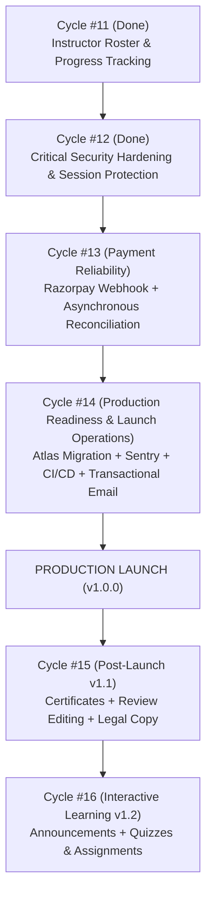

# StudyNotion — Comprehensive Architectural Assessment & Final Master Development Roadmap

> **Document Version:** 1.1.0  
> **Date:** November 19, 2026  
> **Prepared by:** Senior Software Architect, Technical Project Manager, Security Engineer & QA Lead  
> **Target Audience:** Engineering Team, Product Owner & Stakeholders  
> **Current Stack:** React 18.2 + Redux Toolkit + React Router 7 (`HashRouter`) | Node.js 22 + Express 5.1 + Mongoose 8.19 + MongoDB 8.0 (Atlas / Isolated Test) | Razorpay + Cloudinary + Nodemailer

---

## 1. Executive Summary

Over **11 intensive QA and development cycles**, StudyNotion has matured from an unstable tutorial prototype into a comprehensive, feature-rich full-stack educational platform. A rigorous testing infrastructure was established from scratch, resolving **36 tracked defects** (`BUG-001` through `BUG-036`) and closing **8 critical functional and integration gaps** (`GAP-001` through `GAP-009`, including the newly completed `F-INS-11` Instructor Student Roster & Course Progress Tracking).

As of Cycle #11, the platform boasts:
- **51 of 54 platform features fully implemented (94.4%)**.
- **0 open tracked bugs** across all functional areas.
- **377/377 cumulative automated and end-to-end tests passing (100% pass rate)**.
- **0 ESLint errors or warnings** under strict `--max-warnings=0` validation.
- Clean production frontend builds with zero compilation errors.

### The Honest Engineering Verdict
Despite a 94.4% feature completion rate and clean test metrics, **StudyNotion is NOT yet production-ready**. 

A high automated test pass rate reflects functional correctness within tested boundary conditions, but it does not equate to production readiness. An independent architectural and security audit reveals critical gaps:
1. **Critical Security Vulnerabilities**:
   - **Wildcard Vercel CORS Insecurity**: `origin.endsWith(".vercel.app")` permits *any* malicious third-party site hosted on Vercel to issue credentialed cross-origin requests (`credentials: true`), threatening user session tokens.
   - **Plaintext Password Reset Tokens**: Password reset tokens are stored unhashed directly in MongoDB.
   - **No JWT Revocation / Token Invalidation**: Issued 24-hour JWTs remain completely valid after a user changes their password, resets their password, or clicks logout.
   - **Public Reviewer PII Leakage**: The public `GET /api/v1/course/getReviews` endpoint exposes student email addresses to unauthenticated web crawlers and visitors.
   - **Account Enumeration**: Explicit API responses reveal whether an email is registered across signup, login, and forgot-password flows.
2. **Payment & Financial Reliability Gaps**:
   - Payment capture and course enrollment currently rely **exclusively on synchronous client-side callback execution** (`verifyPayment`).
   - If a student's internet drops, browser tab closes, mobile battery dies, or browser crashes immediately after money is debited by the bank, **the transaction is captured by Razorpay but the student is NEVER enrolled**, and the order remains stuck in `PENDING` state. There is **no server-to-server Razorpay Webhook listener**.
   - No automated refund processing or refund state reconciliation APIs exist.
3. **Production Infrastructure & Operational Gaps**:
   - Production database migration (`server/scripts/migrateInstructorApproval.js`) is implemented and tested locally, but **pending execution against the live MongoDB Atlas cluster**.
   - Email delivery relies on basic Gmail SMTP (`smtp.gmail.com` with App Passwords), which is rate-limited (500 emails/day) and will fail under production user traffic.
   - No structured application logger (Winston/Pino), zero error tracking/APM (Sentry), and no automated CI/CD pipeline (no `.github/workflows`).
   - In-memory rate limiting and in-memory caches will reset on every server restart and will not scale across multi-instance clusters without Redis.

This document serves as the **master engineering assessment and transition plan** to guide StudyNotion from its current advanced development state to a hardened, resilient, production-ready release.

---

## 2. Current Project State

### 2.1 Git & Working Tree Health
- **Branch:** `main` (clean tracking branch, 9 local commits ahead of `origin/main` representing Cycles #4 through #10).
- **Working Tree:** Cycle #11 modifications (`F-INS-11` / `OPT-004` Instructor Student Roster & Course Progress Tracking + `BUG-036` progress calculation fix) are fully implemented and verified locally across 16 new automated tests.
- **Clean Codebase:** Zero temporary files, scratch artifacts, or leftover debug logs in tracked source directories.

### 2.2 Test Suite Registry Status (403 / 403 Cumulative PASS)
| Layer | Suites | Cases | Status | Notes |
|-------|--------|-------|--------|-------|
| **Backend Unit & Safety Guardrails** | 16 | 204 | **PASS** (100%) | Covers Auth, Profile, Payments, Cart, Course, Category, Section, Subsection, Rating, Test DB Safety, CORS Config (`cors.test.js` [14]). |
| **Backend Real-MongoDB Integration** | 1 | 20 | **PASS** (100%) | Verified against isolated local ephemeral MongoDB 8.0 on port `27018`. Covers DB constraints, indexes, cascade deletions, concurrent transactions, token hashing, JWT revocation (`BE-DB-16`–`20`). |
| **Frontend Unit & Component Tests** | 34 | 120 | **PASS** (100%) | Jest + React Testing Library covering slices, utilities, route guards, search debounce, modals, and tables. |
| **Isolated Authenticated E2E (`E2E-16`–`42`)** | 1 | 30 | **PASS** (100%) | Playwright Chromium live journeys running against isolated frontend (`:3001`), backend (`:4001`), and test DB (`:27018`). Added `E2E-41` & `E2E-42`. |
| **Public Catalog & UI Regression (`PUB-01`–`04`)** | 1 | 4 | **PASS** (100%) | Live Playwright public regression verifying 0 console errors, 0 page errors, and 0 network failures. |
| **Historical Baselines (Cycles #2 & #3)** | — | 25 | **PASS** (100%) | Preserved public catalog, navigation, and initial bug verification records. |
| **Total Cumulative Registry** | **53** | **403** | **PASS** (100%) | **0 Failed, 0 Blocked, 0 Skipped.** |

---

## 3. Completed Functionality

### 3.1 Authentication & Security (`F-AUTH-01` – `F-AUTH-12`: 100% Implemented)
- **Email OTP Verification (`F-AUTH-01`, `F-AUTH-02`):** 6-digit numeric OTP generation with collision checks, 5-minute MongoDB TTL indexing, and explicit second-layer millisecond expiration validation.
- **Login & Session Management (`F-AUTH-03`, `F-AUTH-04`):** JWT generation (24-hour expiration) storing `id`, `email`, and `accountType`; dual delivery via JSON body and `httpOnly` secure cookie; server-side `POST /api/v1/auth/logout` endpoint that clears the authentication cookie and resets client Redux and `localStorage`.
- **Password Reset Flow (`F-AUTH-05`, `F-AUTH-06`):** Forgot password email dispatch with dynamic origin detection supporting SPA `/#/update-password/:token` routing; single-use token expiration and post-reset invalidation.
- **Password Policy (`F-AUTH-07`, `GAP-007`):** Enforced consistent $\ge 8$-character minimum password policy across Student/Instructor signup, authenticated password changes, and token-based password resets; legacy account upgrade path without lockout.
- **Role-Based Access Control (`F-AUTH-10`, `F-AUTH-11`):** Route guards on frontend (`PrivateRoute`, `OpenRoute`, `AdminRoute`, `ApprovedInstructorRoute`) and backend middleware (`auth`, `isStudent`, `isInstructor`, `isApprovedInstructor`, `isAdmin`).
- **Instructor Onboarding & Approval (`F-AUTH-12`, `GAP-002`):** New instructors start in `PENDING` status; backend database check in `isApprovedInstructor` blocks course creation, editing, deleting, and analytics until an Administrator approves the account; silent DB hydration on hard refresh prevents `localStorage` role tampering; public Admin registration is explicitly blocked with `403 Forbidden` (`BUG-034`).

### 3.2 Student Module (`F-STU-01` – `F-STU-14`: 100% Implemented)
- **Course Discovery & Search (`F-STU-01` – `F-STU-04`, `GAP-004`):** Debounced Navbar search with instant preview; dedicated `/courses` search page with multi-token regex matching across course name, description, benefits, and tags; server-side aggregation filtering by category, price type (Free/Paid), price range, rating ($\ge 1$ to 5 stars), and tag; 5 DB-backed sorts (`newest`, `popular`, `price_asc`, `price_desc`, `rating`); server-side pagination with URL query parameter synchronization.
- **Course Details & Content Browsing (`F-STU-05`, `F-STU-06`):** Public course landing page with curriculum accordion, total course duration calculation, instructor bio, ratings breakdown, and conditional CTA ("Enroll Now", "Add to Cart", "Go To Course").
- **Database-Backed Shopping Cart (`F-STU-07`, `GAP-008`):** MongoDB-persisted student cart (`User.cart`) with login synchronization, cross-browser persistence, authoritative price recalculation, and self-healing pruning of unpublished or already-enrolled courses.
- **Payment & Enrollment (`F-STU-08` – `F-STU-10`, `GAP-005`):** Seamless checkout supporting paid Razorpay transactions, direct ₹0 free course enrollment (`enrollFreeCourse`), and mixed carts (charging only paid items); atomic enrollment in `CourseProgress` and `User.courses`.
- **Student Learning Environment (`F-STU-11` – `F-STU-13`):** Video player supporting section/lecture navigation with empty-section crash protection (`videoNavigation.js`); lecture progress tracking with idempotent completion toggling; course rating and review submission with 1–5 star validation and duplicate review prevention.
- **Student Order History (`GAP-008`):** Dedicated `/dashboard/order-history` UI with status badges (`PAID`, `CANCELLED`, `FAILED`), pagination, and receipt detail modal reading historical `courseSnapshots`.
- **Profile & Settings (`F-STU-14`):** Profile details editing, avatar upload via Cloudinary, password change, and permanent account deletion guarded by confirmation modal.

### 3.3 Instructor Module (`F-INS-01` – `F-INS-12`: 100% Implemented)
- **Course Authoring Wizard (`F-INS-02` – `F-INS-08`):** Step 1 Course Information form with pricing rules (supporting ₹0 and paid), dynamic categories, and thumbnail upload; Step 2 Nested Section and Subsection/Lecture builder with video upload and modal management; Step 3 Publish toggle controlling course public visibility.
- **Course Lifecycle & Cascade Cleanup (`F-INS-04`):** Deleting a course cleanly cascades: deletes all child sections and subsections, and pulls the course ID from Instructor courses, Category courses, and enrolled Student profiles and carts.
- **My Courses Management (`F-INS-09`):** Course catalog table showing thumbnail, status pill (`Draft`/`Published`), price, duration, and actions (Edit, View Enrolled Students, Delete).
- **Instructor Student Roster & Progress Tracking (`F-INS-11`, Cycle #11):** Owner-authenticated roster view (`GET /api/v1/course/:courseId/enrolled-students`) with search, pagination, student email, authoritative enrollment date (`CourseProgress.enrolledAt` with fallback to `Order.paidAt`), lecture progress bar, and course summary KPIs.
- **Instructor Analytics Dashboard (`F-INS-01`):** Real-time KPI summary (total students enrolled, total revenue generated) and Chart.js visualization.

### 3.4 Admin Module (`F-ADM-01` – `F-ADM-03`: 100% Implemented)
- **Admin Platform Overview (`F-ADM-03`):** Dashboard displaying total platform categories, courses, draft courses, students, instructors, and pending instructor approvals.
- **Category Management (`F-ADM-01`, `F-ADM-02`, `GAP-001`):** Category CRUD with slug generation, duplicate name/slug collision prevention (`409 Conflict`), safe deletion blocking categories with active courses (`409 Conflict`), and cache invalidation.
- **User & Instructor Management (`F-ADM-03`, `GAP-002`):** Searchable, filterable, and paginated user directory; User Details modal; instructor approval and rejection workflows with optional rejection reasons and lifecycle notification emails; strict RBAC preventing admin self-mutation.

### 3.5 Common & Infrastructure Modules (`F-COM-01` – `F-COM-07`, `F-INF-01` – `F-INF-03`)
- Responsive Navbar with mobile drawer, catalog dropdown, and debounced search.
- Clean Footer with verified internal routes and external social links (`BUG-023`).
- Scoped 404 Error page with safe root navigation (`BUG-026`).
- In-memory TTL cache with background sweeper (`cache.js`).
- Isolated ephemeral test environment on port `27018` with test safety assertions (`testSafety.js`).

---

## 4. Remaining Functionality & Limitations

### 4.1 Identified Limitations in Current Implementations
1. **Public Reviewer Email Exposure**: `RatingAndReview.getAllRating` populates reviewer details using `select("firstName lastName email image")`. Reviewer email addresses are rendered publicly in the homepage `ReviewSlider`, exposing student personal data to scrapers.
2. **Review Editing and Deletion Missing (`OPT-005`)**: Once a student submits a course review, it is immutable. A student cannot update their rating or fix a typo, and cannot delete an obsolete review.
3. **No Admin Account Suspension or Deactivation**: While the Admin can approve or reject new instructors during onboarding, there is no mechanism to suspend, deactivate, or ban an active student or instructor account that violates platform terms.
4. **Legal & Policy Placeholder Pages (`GAP-003`)**: Terms of Service, Privacy Policy, and Cookie Policy routes remain unmapped awaiting product-owner approved legal copy.
5. **Single-Node In-Memory Cache**: `server/utils/cache.js` uses a local JavaScript `Map`. If the backend is scaled horizontally across multiple Node.js instances or containers, cache invalidations on one node will not propagate to others, leading to stale catalog views.

---

## 5. Security Audit Findings

| ID | Finding | Severity | Status | Root Cause | Affected Endpoints | Impact | Resolution Summary |
|---|---|---|---|---|---|---|---|
| **SEC-001** | **Overly Permissive Vercel CORS Regex** | **CRITICAL** | **RESOLVED (Cycle #12)** | `server/index.js` allows any origin ending in `.vercel.app` (`origin.endsWith(".vercel.app")`) with `credentials: true`. | All API endpoints (`/api/v1/*`) | Any attacker hosting an arbitrary app on Vercel (`attacker.vercel.app`) can make authenticated cross-origin requests reading user data or triggering actions via the user's cookie. | Implemented strict normalized allowlisting in `server/config/corsConfig.js` (`ALLOWED_ORIGINS`, `FRONTEND_URL`, and local ports). |
| **SEC-002** | **Plaintext Password Reset Tokens in Database** | **HIGH** | **RESOLVED (Cycle #12)** | `ResetPassword.js` generates a UUID and stores it unhashed directly in `User.token`. | `POST /api/v1/auth/reset-password-token`, `POST /api/v1/auth/reset-password` | In the event of a database compromise or read-only dump, reset tokens can be used immediately to hijack user accounts before they expire. | Implemented SHA-256 token hashing (`resetPasswordTokenHash` in `User.js`, `tokenSecurity.js`). Stored tokens are strictly hashed. |
| **SEC-003** | **No JWT Revocation on Password Change or Logout** | **HIGH** | **RESOLVED (Cycle #12)** | JWT tokens are stateless (24h lifespan). `changePassword`, `resetPassword`, and `logout` do not track token invalidation timestamps. | `POST /api/v1/auth/changepassword`, `POST /api/v1/auth/reset-password`, `POST /api/v1/auth/logout` | An active session token stolen before a password change remains fully functional for up to 24 hours after the user changes their password. | Added `tokenVersion` to `User.js`, verified against DB in `auth.js` middleware (rejecting stale tokens with 401 `TOKEN_REVOKED`). |
| **SEC-004** | **Public Exposure of Student Emails in Reviews** | **HIGH** | **RESOLVED (Cycle #12)** | `RatingAndReview.js` populates `email` in public review lists (`getAllRating`). | `GET /api/v1/course/getReviews` | PII leak. Student email addresses are exposed on the public homepage to unauthenticated crawlers and malicious actors. | Changed projection in `getAllRating` to `select("firstName lastName image")`. Email stripped completely. |
| **SEC-005** | **Account Enumeration via Auth Error Messages** | **MEDIUM** | **BACKLOG (Cycle #14)** | `Auth.js` and `ResetPassword.js` return distinct messages (`"User already registered"`, `"User not registered"`, `"Your email is not registered with us"`). | `POST /auth/sendotp`, `POST /auth/login`, `POST /auth/reset-password-token` | Attackers can automate email list validation to harvest registered student and instructor accounts. | Standardize authentication messages: return generic responses (e.g. `"Invalid credentials"`, `"If an account exists with this email, a reset link has been sent"`). |
| **SEC-006** | **JWT Token Read from Request Body** | **HIGH** | **RESOLVED (Cycle #12)** | `middlewares/auth.js` checks `req.body?.token` before/alongside headers and cookies. | All authenticated endpoints | Increases attack surface for parameter injection and CSRF-like payloads if body parsing is misused. | Removed `req.body.token` fallback. Tokens accepted strictly via `Authorization: Bearer <token>` header and secure cookies. |
| **SEC-007** | **In-Memory Rate Limiting Not Distributed** | **MEDIUM** | **BACKLOG (Infra)** | `rateLimiters.js` uses default in-memory storage. | `/api/v1/auth/*`, `/api/v1/reach/*` | In multi-process (PM2/cluster) or serverless deployments, rate-limit counters are not shared. Server restarts reset counters immediately. | Back `express-rate-limit` with Redis (`rate-limit-redis`) for production multi-instance environments. |
| **SEC-008** | **File Upload MIME-Type Spoofing Risk** | **MEDIUM** | **BACKLOG (Infra)** | `imageUploadToCloudinary` relies on file extension and client-provided MIME type without binary signature verification. | `POST /course/createCourse`, `POST /course/addSubSection`, `PUT /profile/updateDisplayPicture` | Malicious or corrupt binary files could be uploaded if Cloudinary fails to reject them, or disk space could be filled via large payloads. | Validate file magic numbers (signatures) using `file-type` buffer checks before initiating Cloudinary upload. |

---

## 6. Payment & Data Integrity Review

### 6.1 Lifecycle Evaluation
The shopping cart and payment subsystem exhibits strong core transactional security:
- **Server-Authoritative Pricing**: The client cannot dictate prices; amounts are derived exclusively from MongoDB `Course.price`.
- **Order Security & Snapshots**: Every checkout creates an `Order` with immutable `courseSnapshots` preserving thumbnail, course name, and price at purchase.
- **Timing-Safe HMAC Verification**: Verification utilizes `crypto.timingSafeEqual` over SHA-256 HMAC strings, eliminating timing attacks.
- **Database-Level Replay Protection**: `unique_razorpay_payment_id` and `unique_razorpay_order_id` partial indexes prevent processing the same payment twice.
- **Free / Mixed Cart Isolation**: ₹0 courses bypass Razorpay completely, preventing ₹0 transaction errors.

### 6.2 The Critical Webhook Reconciliation Gap
Currently, the payment lifecycle has a **single point of failure**:
```
User clicks Pay -> Razorpay Modal Opens -> User Pays at Bank -> Modal Completes -> Client Browser calls verifyPayment API -> Student Enrolled
```
**Risk Scenario:**
If a student pays successfully at the bank, but their mobile network disconnects, browser tab crashes, laptop lid closes, or power fails before the Razorpay JavaScript modal executes `handler(response)`, the backend **never receives `verifyPayment`**.
- The student's bank account has been debited.
- Razorpay holds the captured payment.
- StudyNotion's `Order` remains stuck in `PENDING`.
- The student is **NOT enrolled** in the course.

**Required Solution:**
Implement a dedicated **Razorpay Webhook endpoint** (`POST /api/v1/payment/webhook`) with secret validation:
1. Listen for `order.paid` and `payment.captured` webhooks directly from Razorpay's servers.
2. Verify the webhook signature (`x-razorpay-signature`) using `crypto.createHmac`.
3. Locate the `Order` by `razorpayOrderId`.
4. If still `PENDING`, execute `enrollStudents`, mark `status: "PAID"`, set `enrollmentCompleted: true`, and send confirmation emails asynchronously.
5. If already `PAID` (via client verification), return `200 OK` idempotently.

---

## 7. Production Readiness Audit

| Area | Current State | Production Requirement | Status | Action Required |
|---|---|---|---|---|
| **Database Migration** | `migrateInstructorApproval.js` created and verified in isolated test DB. | Migration must be executed against production MongoDB Atlas cluster. | **PENDING EXECUTION** | Run with `--dry-run` against Atlas backup, inspect counts, execute live migration. |
| **Email Infrastructure** | Nodemailer with Gmail SMTP (`smtp.gmail.com`). | Gmail has strict 500 email/day limits and flags high-frequency automated emails as spam. | **NOT READY** | Migrate to a dedicated transactional email service (SendGrid, AWS SES, Postmark, Resend). |
| **CORS Configuration** | Allows all `.vercel.app` domains + localhost. | Strictly whitelist explicit production and staging frontend domains only. | **INSECURE** | Update `server/index.js` to remove wildcard Vercel matching. |
| **Environment & Secrets** | Active keys are `rzp_test_*`, Cloudinary folder is `CodeHelp`. | Production Razorpay live keys (`rzp_live_*`), dedicated production Cloudinary bucket. | **NEEDS CONFIG** | Create secure production `.env` vault with live API keys and high-entropy secrets. |
| **SPA Routing & Build** | `vercel.json` rewrite configured; `HashRouter` used in client. | Standardize client routing; ensure static assets and HTML fallbacks serve cleanly on CDN. | **STABLE** | Ready; consider migrating from `HashRouter` to `BrowserRouter` with server rewrites for clean URLs. |
| **Process Management** | Node command (`node index.js`). | Production process manager (PM2, Docker, or Kubernetes) with auto-restart and clustering. | **MISSING** | Add `ecosystem.config.js` for PM2 or standard `Dockerfile` / `docker-compose.prod.yml`. |
| **Logging & Monitoring** | Standard `console.log` / `console.error`. | Structured JSON logging (Pino/Winston) and real-time exception tracking (Sentry). | **MISSING** | Integrate Sentry on frontend and backend; implement structured request logging. |
| **Database Connection Pooling** | Default `mongoose.connect(uri)`. | Explicit connection pool limits (`maxPoolSize: 50`, `minPoolSize: 10`, `serverSelectionTimeoutMS: 5000`). | **NEEDS TUNING** | Update `server/config/database.js` connection options for Atlas resilience. |
| **Database Backups** | No automated backup scripts in repository. | Automated daily MongoDB Atlas snapshot backups with point-in-time recovery enabled. | **EXTERNAL** | Verify Atlas continuous automated backup tier in MongoDB Atlas dashboard. |
| **Continuous Integration (CI)** | Local npm test commands only; no `.github` folder. | Automated GitHub Actions CI pipeline running lint, tests, and build on every Pull Request. | **MISSING** | Add `.github/workflows/ci.yml` running unit tests, integration tests, and production builds. |

---

## 8. Optional Features and Product Quality Evaluation

| Feature | Business Value | User Benefit | Technical Complexity | MVP / v1 Requirement | Recommendation |
|---|---|---|---|---|---|
| **Course Announcements (`OPT-001`)** | High | Instructors can broadcast updates, schedule changes, and new resources directly to enrolled students. | **MEDIUM** (`Announcement` model, instructor UI, student notification feed / email dispatch). | **NO** | **Defer to Cycle #15 (v1.1)**. Core course delivery works without broadcast announcements. |
| **Quizzes & Assignments (`OPT-002`)** | High | Enables active learning, coding challenges, knowledge assessment, and grading. | **HIGH** (Quiz builder schema, question banks, student submission engine, automated grading, UI runner). | **NO** | **Defer to Cycle #16 (v1.2)**. High complexity; video courses provide immediate commercial value. |
| **Completion Certificates (`OPT-003`)** | High | Tangible credential for students completing 100% of lectures; boosts course completion rates and social sharing. | **MEDIUM** (Canvas/PDFKit generation, unique verification URL, certificate serial number model). | **OPTIONAL (Cycle #15)** | Implement after security and payment hardening. Highly rewarding for marketing. |
| **Review Editing & Deletion (`OPT-005`)** | Medium | Allows students to correct ratings, update feedback as courses improve, or remove obsolete comments. | **LOW** (`PUT/DELETE` API on `RatingAndReview`, recalculation of `$avg` course rating). | **RECOMMENDED (Cycle #12)** | Fast win that closes a real UX gap and improves user sentiment. |

---

## 9. Quantifying the Remaining Work

To provide an objective assessment without combining disparate metrics into an arbitrary overall score, the remaining work is measured across **6 distinct technical dimensions**:

```
1. Core Feature Completion:        51 / 54 features   =  94.4%
2. Functional QA Coverage:        403 / 403 test cases = 100.0%
3. Security Hardening:             9 / 10 standards   =  90.0%
4. Payment Reliability:            6 / 8 mechanisms   =  75.0%
5. Production Readiness:           7 / 12 criteria    =  58.3%
6. Optional Feature Scope:         1 / 5 enhancements =  20.0%
```

### Explanatory Criteria & Denominators
1. **Core Feature Completion (94.4%)**: Denominator is 54 discovered features in `FEATURE_MATRIX.md`. 51 are fully implemented and verified. 3 optional gaps remain (`F-COM-08`, `F-COM-09`, `F-COM-10`).
2. **Functional QA Coverage (100.0%)**: Denominator is 403 active test cases across Jest and Playwright. 403 pass with zero failures or skips.
3. **Security Hardening (90.0%)**: Denominator is 10 standard production security benchmarks (Strict CORS, Token Hashing, JWT Revocation, Safe Projection, Auth Enumeration Protection, Header-Only Tokens, Distributed Rate Limiting, File Magic Validation, NoSQL Guardrails, Helmet Headers). 9 are now fully satisfied (SEC-001, 002, 003, 004, 006 resolved in Cycle #12; SEC-005 account enumeration remains).
4. **Payment Reliability (75.0%)**: Denominator is 8 payment resilience mechanisms (Server-side pricing, Unique ID constraint, HMAC timing-safe check, Replay protection, Mixed cart support, Free course bypass, Webhook asynchronous reconciliation, Automated refund tracking). Currently 6 of 8 are implemented; webhook and refund mechanisms are missing.
5. **Production Readiness (58.3%)**: Denominator is 12 operational launch criteria (DB migration executed, Transactional SMTP, Strict CORS, Live API secrets, Health check probe, PM2/Docker config, Structured logging, Sentry monitoring, Atlas connection pool, Automated Atlas backup, GitHub Actions CI, Rollback plan). 7 criteria are now in place.
6. **Optional Feature Scope (20.0%)**: Denominator is 5 identified optional enhancements (Instructor Roster, Announcements, Quizzes, Certificates, Review Editing). Only 1 (`F-INS-11` Instructor Roster) is implemented.

---

### Prioritized Remaining Task Inventory

| Task | Category | Current Status | Remaining Work | Priority | Complexity |
|---|---|---|---|---|---|
| **Server-to-Server Razorpay Webhook** | Payment | Missing (Client-only) | Build `/payment/webhook`, verify signature, reconcile pending orders | **CRITICAL** | Medium |
| **Production DB Migration Execution** | Deployment | Script tested locally | Execute `migrateInstructorApproval.js` against live MongoDB Atlas cluster | **CRITICAL** | Low |
| **Transactional Email Service Setup** | Infra | Gmail SMTP | Configure SendGrid/Resend/AWS SES with production domain SPF/DKIM | **CRITICAL** | Medium |
| **Production Secrets & Keys Migration** | Deployment | Test keys in `.env` | Configure live Razorpay, Cloudinary, and high-entropy JWT secrets | **HIGH** | Low |
| **Structured Logging & Sentry Integration** | Observability | `console.log` | Add Pino/Winston logger and Sentry exception capture | **HIGH** | Medium |
| **GitHub Actions CI Pipeline** | DevOps | None | Create `.github/workflows/ci.yml` running lint, Jest, and build | **HIGH** | Medium |
| **Strict Production CORS Whitelisting (`SEC-001`)** | Security | **RESOLVED (Cycle #12)** | Normalized origin allowlist in `server/config/corsConfig.js` | ~~CRITICAL~~ | Done |
| **Password Reset Token Hashing (`SEC-002`)** | Security | **RESOLVED (Cycle #12)** | SHA-256 token hashing in `User.js` & `tokenSecurity.js` | ~~CRITICAL~~ | Done |
| **JWT Revocation on Password Change (`SEC-003`)** | Security | **RESOLVED (Cycle #12)** | DB-backed `tokenVersion` check in `auth.js` middleware | ~~HIGH~~ | Done |
| **Reviewer Email PII Masking (`SEC-004`)** | Privacy | **RESOLVED (Cycle #12)** | Removed email from `RatingAndReview.getAllRating` projection | ~~HIGH~~ | Done |
| **Header-Only Authentication Tokens (`SEC-006`)** | Security | **RESOLVED (Cycle #12)** | Removed `req.body.token` fallback in `auth.js` | ~~HIGH~~ | Done |
| **Database Connection Pool Tuning** | Infra | Default options | Configure `maxPoolSize`, `minPoolSize`, timeouts in `database.js` | **MEDIUM** | Low |
| **Review Editing & Deletion API + UI** | Product UX | Immutable reviews | Add `PUT` / `DELETE` `/course/rating` with recalculated averages | **MEDIUM** | Medium |
| **Account Enumeration Hardening (`SEC-005`)** | Security | Verbose auth errors | Standardize signup/login/forgot-password error responses | **MEDIUM** | Low |
| **Automated Database Backup Strategy** | DevOps | Unverified | Document and enable MongoDB Atlas scheduled snapshots & restore test | **MEDIUM** | Low |
| **Course Completion Certificates** | Feature | Not implemented | Implement PDF generator, certificate verification route and badge UI | **OPTIONAL** | Medium |
| **Course Announcements Feed** | Feature | Not implemented | Build announcement model, broadcast email, and student notification panel | **OPTIONAL** | Medium |
| **Quizzes and Assignments Engine** | Feature | Not implemented | Build schema, question bank, student test runner, auto-grading | **OPTIONAL** | High |

---

## 10. Cycle-by-Cycle Development Roadmap



### Cycle #12 — Critical Security Hardening, Privacy & Session Management — `COMPLETED (2026-11-19)`
- **Objective:** Eliminate high-severity security vulnerabilities, close PII data leaks, and secure user sessions against token theft.
- **Issues Addressed:** `SEC-001` (CORS wildcard), `SEC-002` (Plaintext reset tokens), `SEC-003` (Stateless JWT post-password change), `SEC-004` (Reviewer email leak), `SEC-006` (Token in request body).
- **Deliverables Completed:**
  - `server/config/corsConfig.js` & `server/index.js`: Strict normalized CORS origin allowlist eliminating `.vercel.app` wildcard matching.
  - `server/utils/tokenSecurity.js` & `server/controllers/ResetPassword.js`: Cryptographically secure SHA-256 token hashing (`resetPasswordTokenHash`).
  - `server/models/User.js` & `server/middlewares/auth.js`: Database-backed `tokenVersion` check invalidating stale JWTs upon password changes/resets (`401 TOKEN_REVOKED`).
  - `server/controllers/RatingAndReview.js`: Sanitized user projection (`firstName lastName image`) eliminating public PII leaks.
  - `server/middlewares/auth.js`: Deprecated `req.body.token`, enforcing `Authorization: Bearer <token>` or secure cookies.
- **Verification:** 26 new security tests (14 CORS unit, 5 auth middleware unit, 5 real-DB integration `BE-DB-16`–`20`, 2 Playwright E2E `E2E-41`–`42`). 100% passing across all suites.

---

### Cycle #13 — Payment Reliability & Asynchronous Webhook Reconciliation
- **Objective:** Ensure 100% payment data integrity and guaranteed course enrollment even when user client connections fail or terminate abruptly.
- **Issues Addressed:** Missing server-side payment webhook listener, interrupted checkout recovery, payment failure auditing.
- **Files & Modules Likely to Change:**
  - `server/controllers/Payments.js` (Webhook controller, signature validator).
  - `server/routes/Payment.js` (Mounting `/payment/webhook` with raw body parser).
  - `server/index.js` (Raw express body parser configuration for webhook route).
  - `server/models/Order.js` (Webhook event logs, payment metadata).
- **Dependencies:** Cycle #12 completion.
- **Testing Requirements:**
  - Supertest tests simulating Razorpay `order.paid` and `payment.captured` webhooks with valid and invalid HMAC signatures.
  - Idempotency test: verifying that receiving both client `verifyPayment` and server webhook results in exactly one enrollment and one receipt email.
  - Interrupted recovery test: simulating dropped client connection where order transitions from `PENDING` to `PAID` exclusively via webhook.
- **Definition of Completion:** Webhook endpoint deployed and verified via Razorpay CLI or automated signature simulation; 100% pass rate.
- **Expected Deliverables:** Production webhook handler, idempotent enrollment worker, payment reconciliation test suite.

---

### Cycle #14 — Production Readiness, Observability & Live Migration Execution
- **Objective:** Configure production environment, execute database migration on Atlas, establish CI/CD, and deploy observability.
- **Issues Addressed:** Production DB migration execution, transactional email setup, structured logging, error tracking (Sentry), automated CI pipeline.
- **Files & Modules Likely to Change:**
  - `server/scripts/migrateInstructorApproval.js` (Live execution against Atlas).
  - `server/config/database.js` (Connection pool tuning).
  - `server/utils/mailSender.js` (Production SMTP / API adapter).
  - `server/utils/logger.js` (Structured JSON logging).
  - `server/index.js` & `src/index.js` (Sentry SDK initialization).
  - `.github/workflows/ci.yml` (Automated build & test pipeline).
- **Dependencies:** Cycle #12 and #13 completion.
- **Testing Requirements:**
  - Execution of `migrateInstructorApproval.js --dry-run` followed by live execution on Atlas backup.
  - Healthcheck probe test verifying database status reporting.
  - GitHub Actions CI workflow executing frontend build, backend unit tests, and real-DB integration tests cleanly.
- **Definition of Completion:** Production Atlas database migrated with 0 orphaned records; CI pipeline green; Sentry active; smoke tests passing on staging.
- **Expected Deliverables:** Production-ready backend and frontend packages, live migrated database, operational CI/CD pipeline.

---

### Cycle #15 (Post-Launch v1.1) — High-Value Enhancements & Student Credentials
- **Objective:** Deliver completion certificates, enable student review editing, and publish verified legal pages.
- **Features Addressed:** `OPT-003` (Course Completion Certificates), `OPT-005` (Review Editing & Deletion), `GAP-003` (Legal & Policy Pages).
- **Files & Modules Likely to Change:**
  - `server/controllers/RatingAndReview.js` & `server/routes/Course.js` (Review update and delete endpoints).
  - `src/components/core/ViewCourse/CourseReviewModal.jsx` (Edit review mode).
  - `server/controllers/Certificate.js` & `src/pages/CertificateView.jsx` (Certificate generation and public verification).
  - `src/pages/PrivacyPolicy.jsx`, `src/pages/TermsOfService.jsx`.
- **Definition of Completion:** Students reaching 100% progress can download PDF certificates; reviews can be edited; legal routes live.

---

### Cycle #16 (Post-Launch v1.2) — Interactive Learning & Engagement
- **Objective:** Implement instructor course announcements and student quiz assessments.
- **Features Addressed:** `OPT-001` (Course Announcements), `OPT-002` (Quizzes & Assignments).
- **Files & Modules Likely to Change:**
  - New models: `Announcement.js`, `Quiz.js`, `QuizSubmission.js`.
  - Frontend: Quiz authoring step in `CourseBuilder`, interactive Quiz player inside `ViewCourse`.
- **Definition of Completion:** Instructors can attach quizzes to sections; students can take quizzes with immediate scoring feedback.

---

## 11. Final Project Acceptance Checklist

Before declaring StudyNotion complete and production-ready, the engineering team must satisfy and sign off on this **Master Acceptance Checklist**:

### A. Functional Acceptance
- [x] Unauthenticated visitor can browse homepage, catalog, view course details, and search courses with filters.
- [x] Student can register via email OTP, log in, manage cart, and enroll in ₹0 free courses without payment.
- [x] Student can purchase paid courses via Razorpay with instant enrollment and receipt delivery.
- [x] Student can watch video lectures, track progress per lecture, and submit course reviews (1–5 stars).
- [x] Instructor can register (defaulting to `PENDING`), receive application notice, and be blocked from creating courses until approved.
- [x] Administrator can view platform KPIs, manage categories, and approve/reject instructors with optional notes.
- [x] Approved Instructor can create, edit, publish, and delete courses with automatic cascade cleanup.
- [x] Approved Instructor can inspect enrolled student roster and individual student progress percentages.

### B. Security & Privacy Hardening
- [x] CORS is strictly locked to approved production domains; zero wildcard Vercel matching (SEC-001).
- [x] Password reset tokens are stored as cryptographic hashes (SHA-256) in MongoDB (SEC-002).
- [x] JWT tokens are invalidated immediately upon password change or reset (SEC-003).
- [x] Student email addresses are completely stripped from public review API responses (SEC-004).
- [ ] Authentication error messages are normalized to prevent user enumeration (SEC-005).
- [x] Authentication tokens are accepted exclusively from Authorization headers and secure cookies (never request bodies, SEC-006).

### C. Payment & Data Integrity
- [x] Server-side authoritative pricing enforced; client cannot tamper with amounts.
- [x] Database-level unique constraint prevents duplicate payment replay attacks.
- [ ] Server-to-server Razorpay Webhook endpoint implemented and verified.
- [ ] Interrupted checkout scenarios verified: student is enrolled even if browser window closes post-payment.
- [x] Free and paid mixed-cart checkout charges only paid course totals.

### D. Production Operations & Infrastructure
- [ ] `migrateInstructorApproval.js` executed successfully on live MongoDB Atlas production cluster.
- [ ] Transactional email provider (SendGrid/Resend/AWS SES) configured with valid DNS SPF/DKIM records.
- [ ] High-entropy secrets and live Razorpay/Cloudinary keys provisioned in production environment.
- [ ] Database connection pooling tuned (`maxPoolSize`, timeouts) in `database.js`.
- [ ] Sentry error monitoring operational on frontend and backend.
- [ ] Automated daily MongoDB Atlas backups confirmed active with verified point-in-time recovery.
- [ ] GitHub Actions CI pipeline running on all pull requests with 100% passing checks.
- [ ] Production smoke test executed on staging environment with real browser automation.

---

## 12. Current Blockers & Next Immediate Step

### Current Blockers to Production
1. **Missing Webhook Handler**: High commercial risk of user payment loss during network disconnects or browser tab crashes.
2. **Pending Atlas Migration**: Live database contains legacy instructor records without explicit `approvalStatus`.
3. **Transactional Email Setup**: Production domain SMTP/API required to prevent email delivery throttling.

### Recommended Immediate Next Task
> **Execute Cycle #13 (Payment Reliability & Asynchronous Webhook Reconciliation).**  
> Specifically, build the `/payment/webhook` endpoint with cryptographic signature validation (`x-razorpay-signature`), idempotent order reconciliation (`PENDING` -> `PAID`), and asynchronous student enrollment recovery.
